# Лабораторная работа: готовый образ Nginx в Docker

**Выполнил:** Михаил

**Цель работы:** запустить веб-сервер Nginx из готового образа Docker Hub, научиться управлять контейнером и отредактировать стартовую страницу `index.html`.

---

## 1. Проверка Docker

Проверил, что Docker установлен, и посмотрел его версию:

```shell
docker version
```

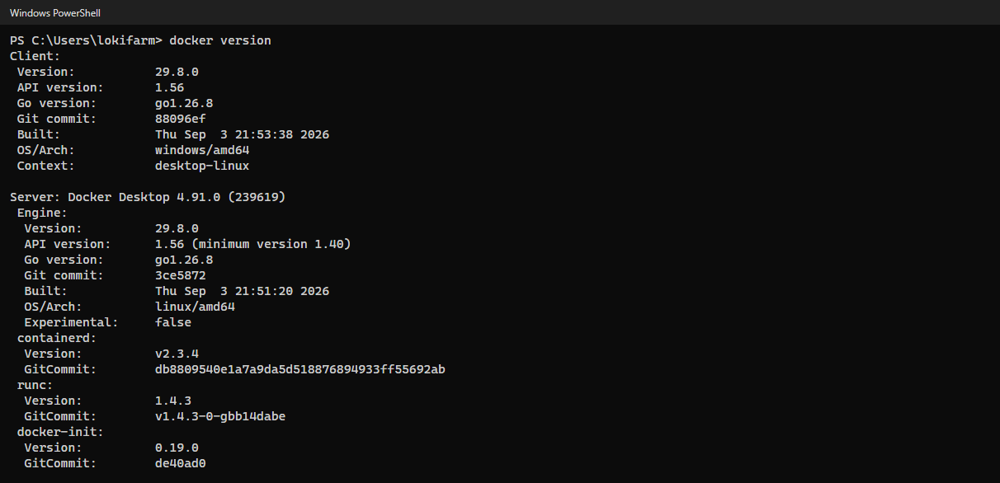

## 2. Подготовка (чистый лист)

Посмотрел, какие контейнеры уже есть, остановил их и удалил остановленные:

```shell
docker ps -a
docker stop $(docker ps -q)
docker container prune -f
docker ps -a
docker images
```

После очистки контейнеров не осталось. Образы `hello-world` и `welcome-to-docker` не трогал, они учебные и нужны для других работ.

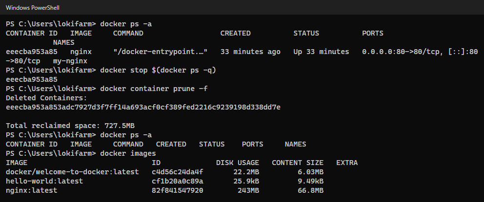

## 3. Получение образа Nginx и запуск контейнера

Нашёл образ на Docker Hub:

```shell
docker search nginx
```

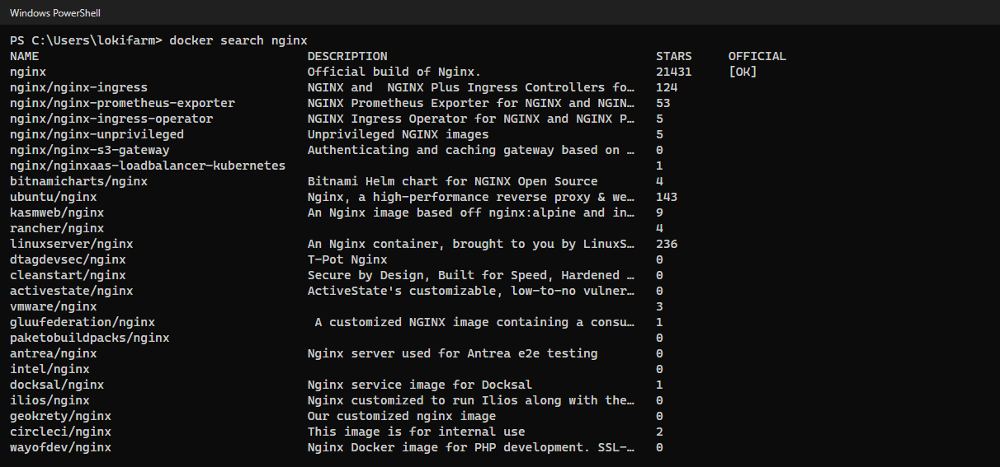

Запустил контейнер. `docker run` сам скачал образ, создал и запустил контейнер:

```shell
docker run -d --name my-nginx -p 80:80 nginx
docker ps -a
```

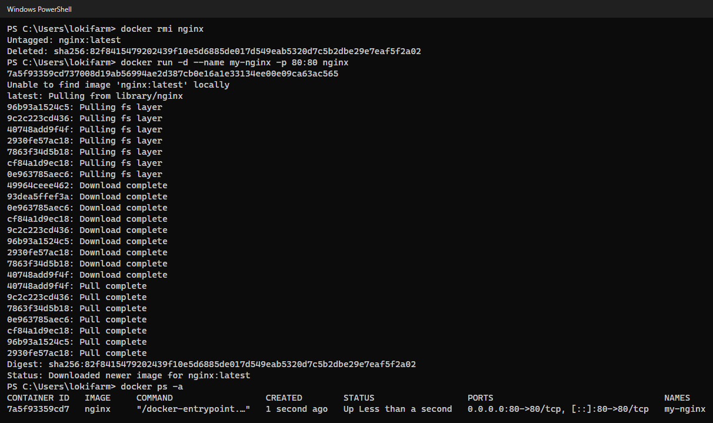

Образ появился в списке:

```shell
docker images
```

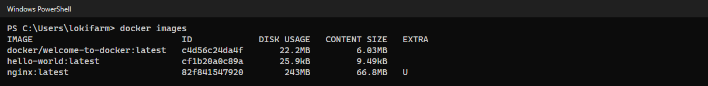

Проверил, что Nginx отвечает. Первый способ, через `curl`:

```shell
curl http://localhost/
```

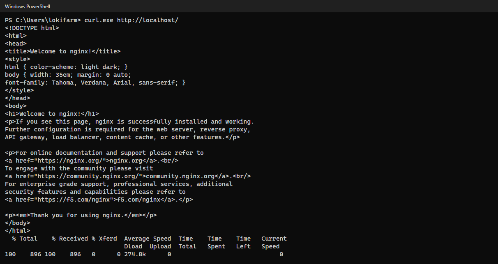

Второй способ, в браузере по адресу http://localhost/:

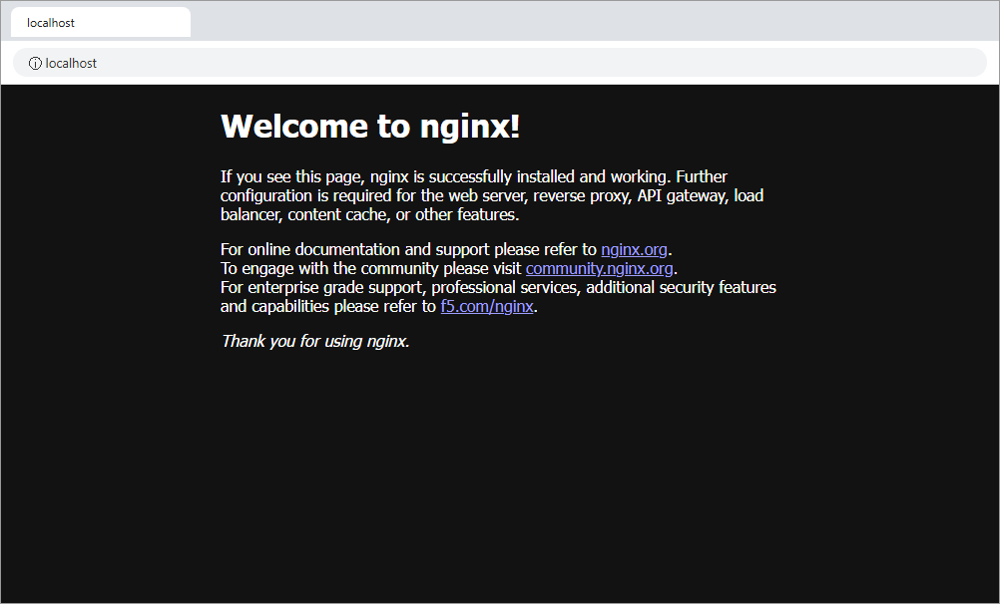

### Остановка, перезапуск и удаление

```shell
docker stop my-nginx
docker restart my-nginx
docker stop my-nginx
docker rm my-nginx
```

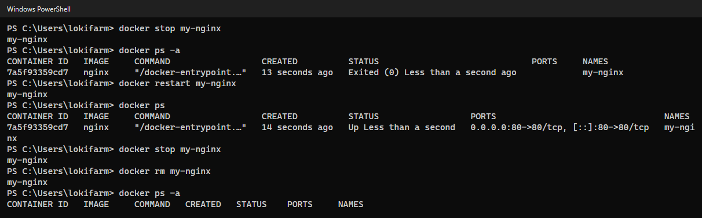

### Второй контейнер из того же образа

Из одного образа можно запустить несколько контейнеров. Запустил второй на порту 81 с другим именем:

```shell
docker run -d --name nginx-my -p 81:80 nginx
```

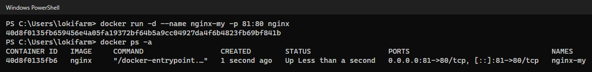

Страница второго контейнера по адресу http://localhost:81/:

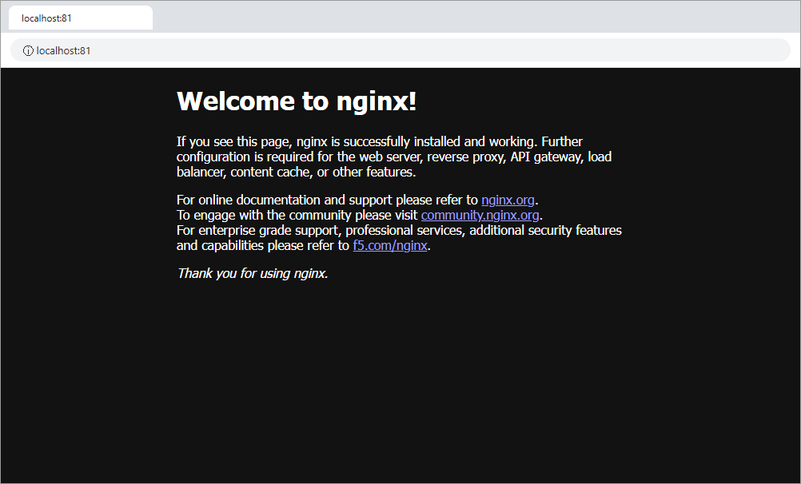

Потом удалил второй контейнер и сам образ:

```shell
docker stop nginx-my
docker rm nginx-my
docker rmi 82f841547920
```

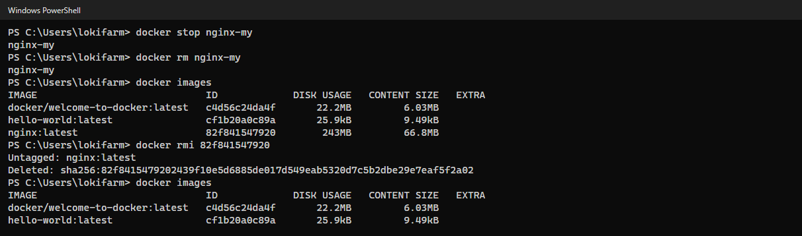

## 4. Повторный запуск

Снова запустил Nginx, образ скачался заново:

```shell
docker run -d --name my-nginx -p 80:80 nginx
docker images
```

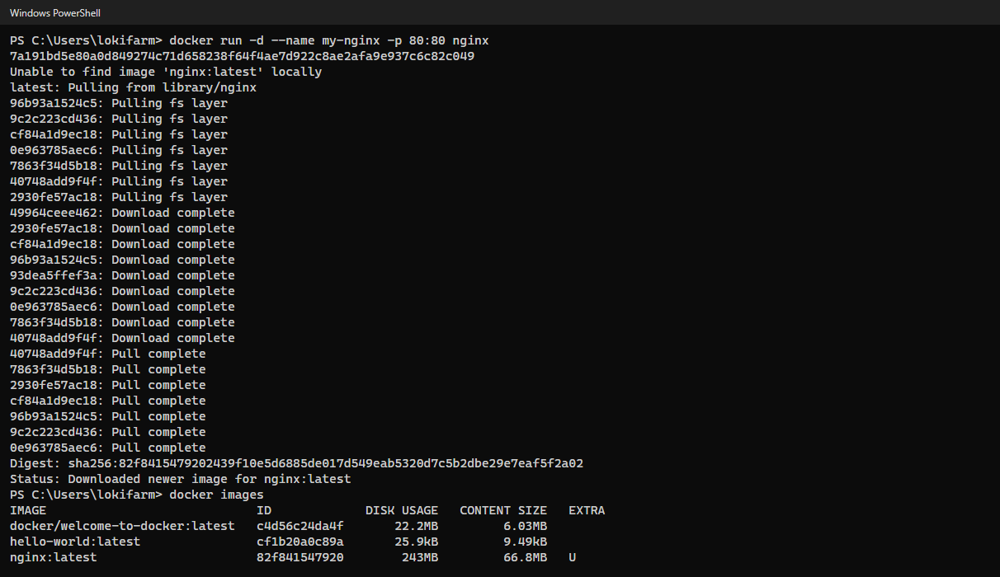

Состояние контейнера:

```shell
docker ps
docker ps -a
```

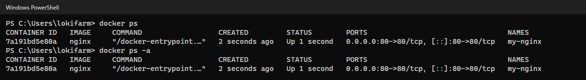

## 5. Управление контейнером

### Мониторинг

Ресурсы, которые потребляет контейнер:

```shell
docker stats --no-stream
```

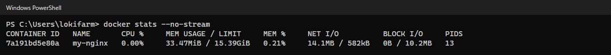

Лог контейнера (видны мои запросы через `curl`):

```shell
docker logs my-nginx
```

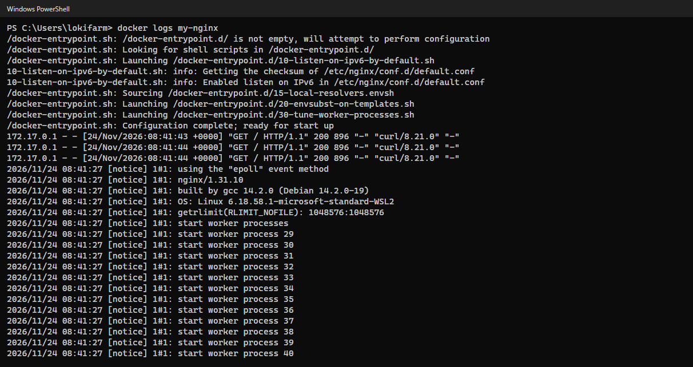

### Работа внутри контейнера

Зашёл в контейнер:

```shell
docker exec -it my-nginx bash
```

Информация об ОС:

```shell
uname -a
cat /etc/os-release
```

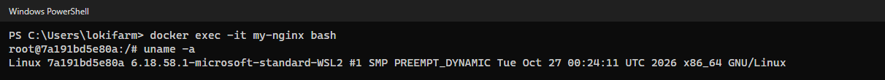

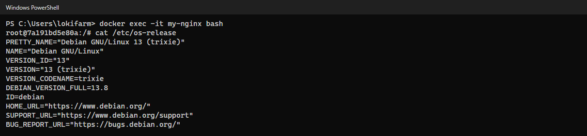

Установил несколько программ:

```shell
apt update && apt install -y fastfetch htop inxi cmatrix hollywood caca-utils mc micro
```

`fastfetch` показывает сводку о системе:

```shell
fastfetch
```

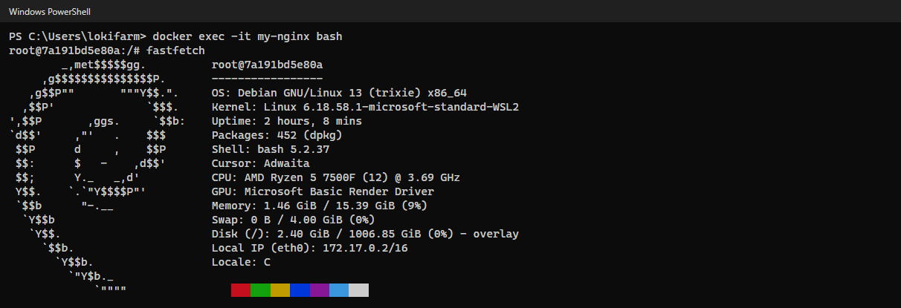

`htop` показывает процессы (видно мастер-процесс nginx и его воркеры):

```shell
htop
```

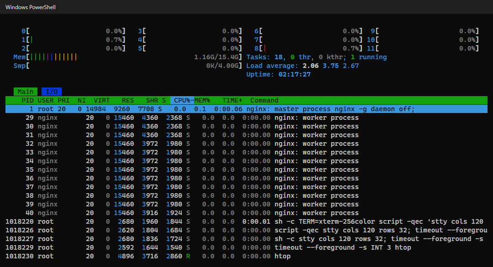

`cmatrix`:

```shell
cmatrix
```

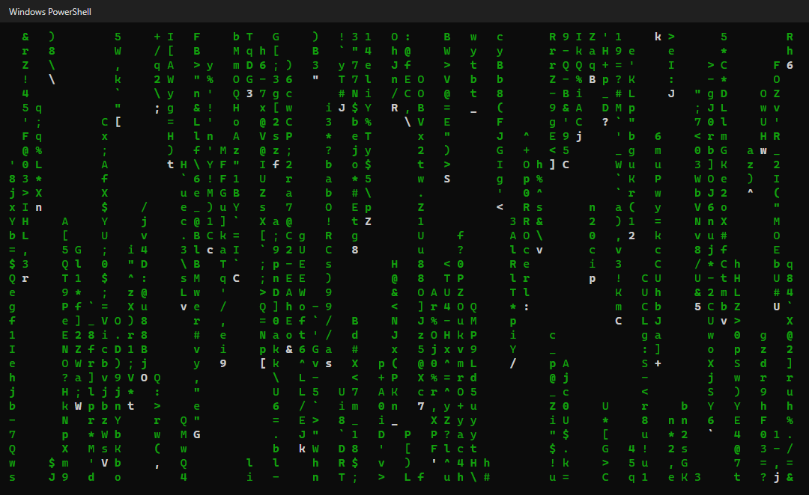

`cacafire`:

```shell
cacafire
```

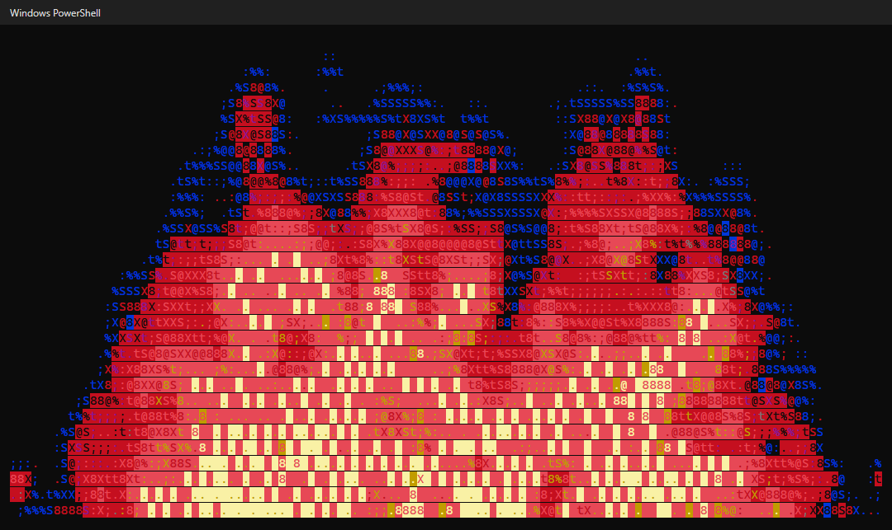

## 6. Редактирование страницы Nginx

Главная часть работы. Стартовая страница лежит в контейнере по пути `/usr/share/nginx/html/index.html`. Я заменил её на свою, на русском языке, с добавлением стилей и своего имени. Готовый файл лежит рядом: [index.html](index.html).

```html
<!DOCTYPE html>
<html lang="ru">
<head>
    <meta charset="UTF-8">
    <title>Приветственная страница index.html</title>
    <style>
        body {
            font-family: Arial, sans-serif;
            background: #eaf2fb;
            color: #1f2d3d;
            text-align: center;
            padding-top: 80px;
        }
        h1 { color: #0b6bcb; }
        p  { font-size: 18px; }
        .author { margin-top: 40px; color: #556; }
    </style>
</head>
<body>
    <h1>Привет из контейнера index.html! 🐳</h1>
    <p>Эта страница отдаётся веб-сервером Nginx из Docker-контейнера.</p>
    <p>Лабораторная работа по Docker: готовый образ Nginx.</p>
    <p class="author">Выполнил: Михаил</p>
</body>
</html>
```

Проверил, что файл внутри контейнера изменился:

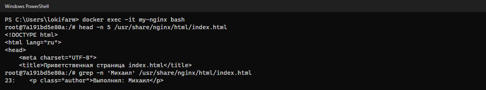

Обновил страницу в браузере, изменения применились:

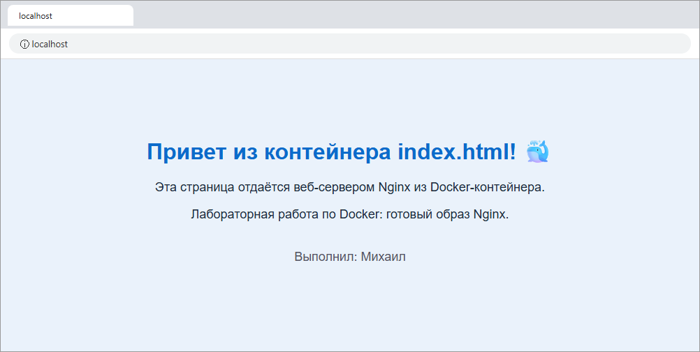

## Вывод

Научился брать готовый образ с Docker Hub, запускать из него контейнеры, смотреть их состояние, логи и нагрузку, заходить внутрь и менять файлы. Отредактировал стартовую страницу Nginx, и она отдаётся уже с моим текстом.
