# Лабораторная работа: Welcome to Docker

**Выполнил:** Михаил

**Цель работы:** запустить готовый образ `docker/welcome-to-docker`, открыть его в браузере, зайти внутрь контейнера и выполнить несколько команд Linux.

---

## 1. Подготовка (чистый лист)

Остановил все запущенные контейнеры, удалил остальные и почистил неиспользуемые тома:

```shell
docker ps -a
docker stop $(docker ps -q)
docker rm -f $(docker ps -aq)
docker volume prune -f
docker ps -a
docker images
```

Контейнеров не осталось. Образы я не удалял (`docker image prune -a` пропустил, он в лабе необязательный).

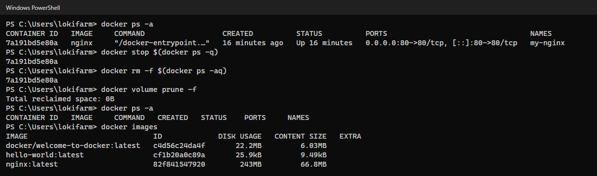

## 2. Проверка порта 8088

Я работаю на Windows, поэтому использовал `netstat` с `findstr`. Команда ничего не вернула, значит порт свободен:

```shell
netstat -aon | findstr :8088
```

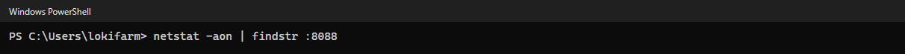

## 3. Запуск контейнера

Создал и запустил контейнер из образа `docker/welcome-to-docker`, порт 8088 хоста пробросил на порт 80 контейнера:

```shell
docker run -d -p 8088:80 --name welcome-to-docker docker/welcome-to-docker
docker ps
```

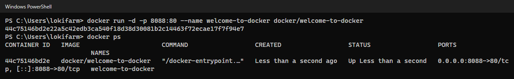

Открыл http://localhost:8088 в браузере, страница приветствия работает:

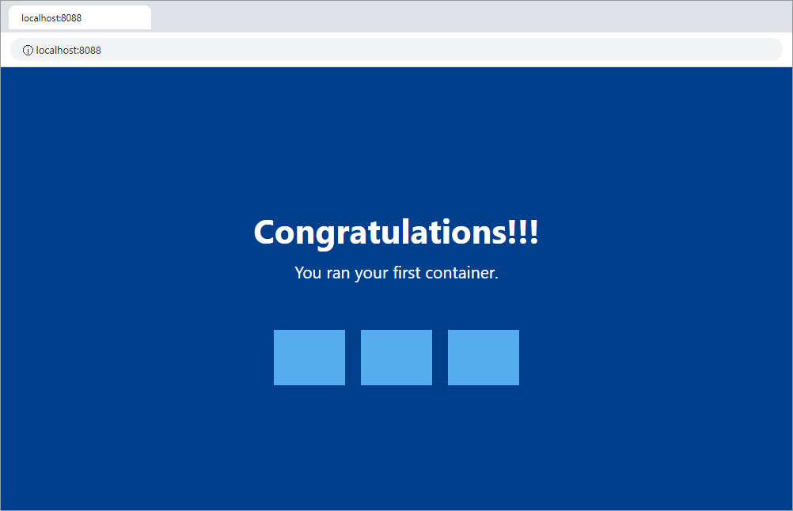

## 4. Работа внутри контейнера

Зашёл в контейнер. В нём Alpine Linux, поэтому оболочка `sh`, а не `bash`:

```shell
docker exec -it welcome-to-docker /bin/sh
```

Информация об ОС:

```shell
uname -a
cat /etc/os-release
```

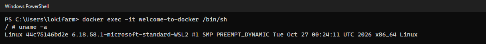

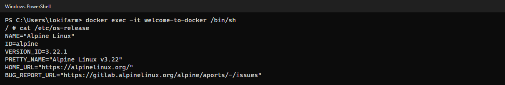

Диспетчер ресурсов `top`. Внутри контейнера работают только процессы Nginx (мастер и воркеры):

```shell
top
```

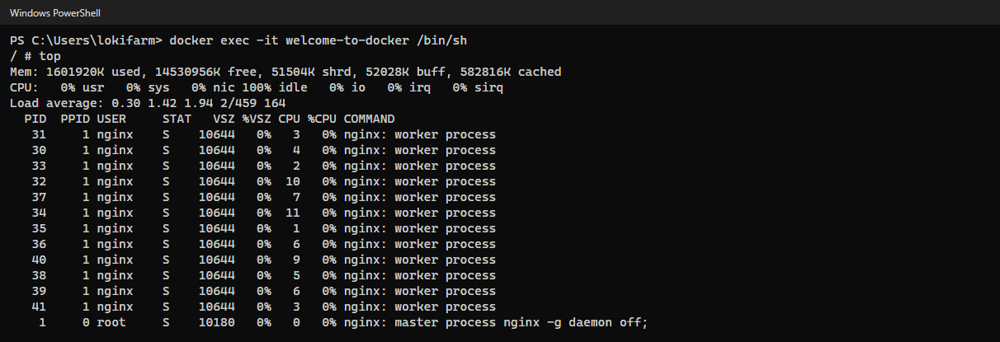

Обновил источники и установил приложения. `tree` в образе не было, поэтому поставил его вместе с `fastfetch`:

```shell
apk update && apk upgrade
apk add fastfetch tree
```

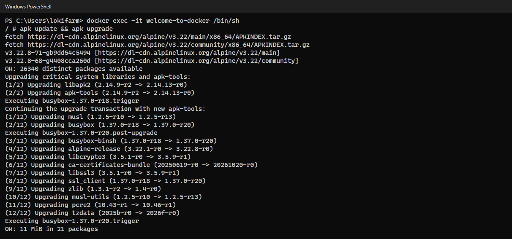

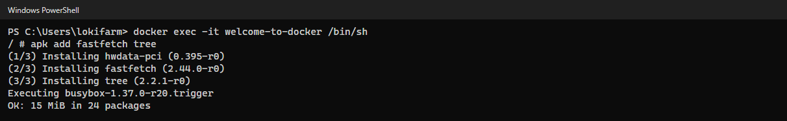

Структура каталогов (вывел только первый уровень, чтобы не было слишком длинно):

```shell
tree -L 1 /
```

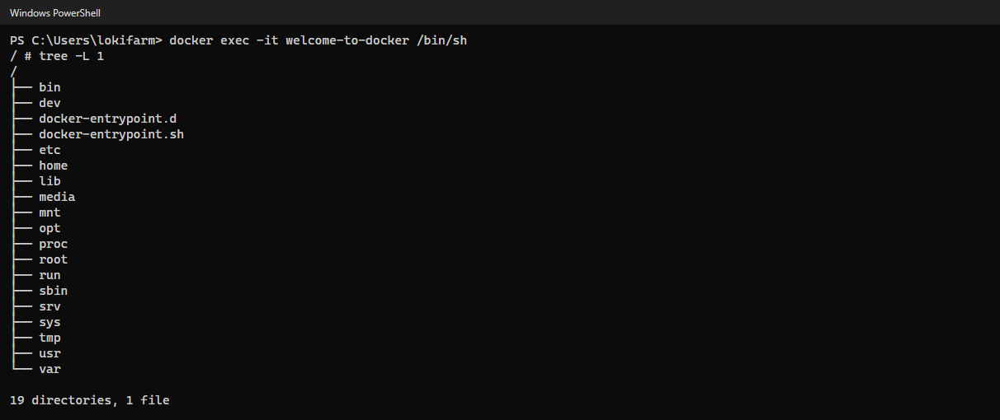

Запустил `fastfetch`:

```shell
fastfetch
```

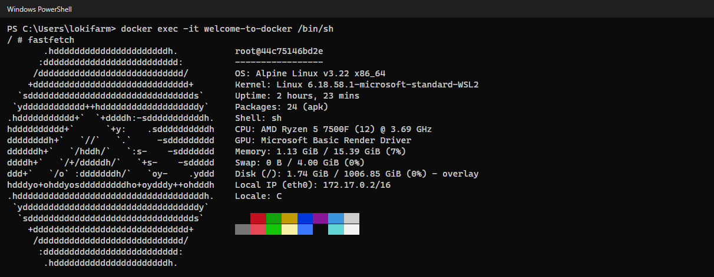

Выход из контейнера: `exit`.

## Вывод

Запустил готовый образ `docker/welcome-to-docker`, проверил его в браузере, поработал внутри контейнера на Alpine Linux: посмотрел информацию об ОС, процессы, обновил пакеты и установил новые приложения через `apk`.
